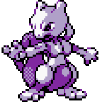

# ✿ Hello, I'm Shreya!

  <i>Exploring ideas, building things, and learning along the way.</i>

  AI & Data Science Undergraduate · Developer · Research Enthusiast

---

### a little about me

I'm someone who loves exploring ideas, solving problems, and understanding how things work. I enjoy the process of turning curiosity into something tangible, whether it's experimenting with AI, building applications, or working on ideas that challenge me to think differently.

I believe in learning by doing, embracing challenges, and getting a little better with every project. There's always something new to discover, something to create, and something to improve.

- ✧ Exploring **AI/ML, Data Science & Software Engineering**
- ✧ Interested in **intelligent systems, creative problem-solving and open source**
- ✧ Love building projects, experimenting with ideas and learning new technologies
- ✧ Enjoy challenges that push me beyond what I already know
- ✧ Always curious about what I can build next

---

### things I work with ✧

**Languages**

**Development**

**AI & Data Science**

**Tools**

---

### selected creations ✧

A few things I've enjoyed building:

<table>
<tr>
<td width="50%">

### 🌊 SeaPulse

Maritime surveillance using AIS data, with vessel tracking and risk detection.

</td>
<td width="50%">

### 🌱 BrandBloom

An AI-powered brand governance platform with document analysis, guideline management and human-in-the-loop approvals.

</td>
</tr>
<tr>
<td width="50%">

### 🎮 Pixel Quest

A React-based gaming platform featuring Wordle, aptitude challenges, quizzes and leaderboards.

</td>
<td width="50%">

### 🍃 SmartFood AI

A food-label analysis application designed to make understanding food ingredients easier.

</td>
</tr>
<tr>
<td colspan="2">

### 🐾 Tenali

An open-source project where I contributed.

</td>
</tr>
</table>

## 💜 My GitHub Contributions

  

  <i>Made with curiosity, a little creativity, and lots of electrolytes. ☁️</i>
  

  

  Thanks for stopping by. Stay curious. ✿

