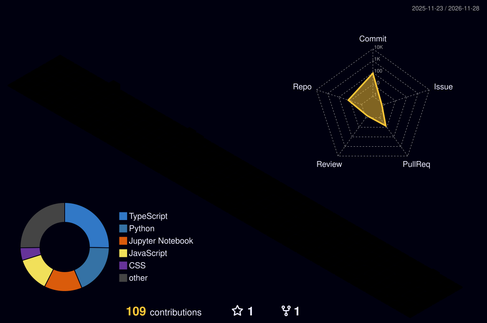

# ✿ Hello, I'm Shreya!

  <i>Exploring ideas, building things, and learning along the way.</i>

  AI & Data Science Undergraduate · Developer · Curious Creator

---

### a little about me

I'm an undergraduate student in Artificial Intelligence and Data Science, interested in building meaningful things with technology.

I enjoy exploring the intersection of AI, software development, and creative problem-solving. From experimenting with machine learning to building web applications, I like turning ideas into something tangible.

- ✧ Currently exploring **AI/ML and Software Engineering**
- ✧ Interested in **intelligent systems, web development and open source**
- ✧ Enjoy experimenting with ideas and learning by building
- ✧ Always curious about what I can create next

---

### things I work with

**Languages**

`Python` · `C` · `C++` · `Java` · `JavaScript` · `SQL`

**Development**

`React` · `Node.js` · `Express.js` · `Flask` · `HTML` · `CSS`

**AI & Data Science**

`NumPy` · `Pandas` · `Scikit-learn` · `NLP` · `Machine Learning`

**Tools**

`Git` · `GitHub` · `VS Code` · `PostgreSQL` · `MongoDB`

---

### selected creations ✧

A few things I've enjoyed building:

**01 · SeaPulse**

Maritime surveillance using AIS data, with vessel tracking and risk detection.

**02 · BrandBloom**

An AI-powered brand governance platform with document analysis, guideline management and human-in-the-loop approvals.

**03 · Pixel Quest**

A React-based gaming platform featuring Wordle, aptitude challenges, quizzes and leaderboards.

**04 · SmartFood AI**

A food-label analysis application designed to make understanding food ingredients easier.

**05 · Tenali**

An open-source project where I contributed.

  <i>Made with curiosity, a little creativity, and lots of electrolytes. ☁️</i>
  

  

  Thanks for stopping by. Stay curious. ✿

<h3 align="center">✦ My Contribution Universe</h3>

  

